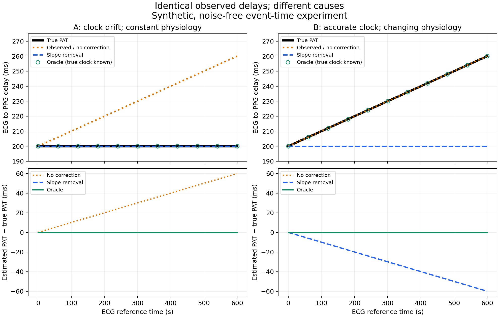

# Assignment 03: Paired timing experiment

Run date: 2026-11-12. Contributor: Bhargav Gandhi, with Codex-assisted implementation.

## Question and specification

Does removing a linear trend from observed ECG–PPG delay correct clock drift
while erasing an indistinguishable physiological change?

This implements [H1 from Assignment 02](assignment-02-literature-and-hypothesis.md#6-one-precise-testable-hypothesis-h1).
The simulation, settings, and predictions are our own specified test case.
The literature and its access limitations are cited in that note; no external
recordings are used here.

## Method

Each scenario contains 601 event pairs at reference times 0 through 600 seconds.
Scenario A has constant true PAT of 200 ms and clock error increasing from 0 to
60 ms. Scenario B has zero clock error and true PAT increasing from 200 to 260 ms.
The observed delays are identical. Beat correspondence is known; noise, filtering,
buffering, and missing events are absent.

Three methods are evaluated:

- No correction: return the observations.
- Slope removal: ordinary least-squares slope estimation followed by subtraction
  of the fitted change since the first time. This function receives observations
  only and retains the initial delay.
- Oracle: subtract the simulated clock error. This uses privileged ground truth
  and is a control, not a deployable algorithm.

## Measured results

All values below are milliseconds, rounded to six decimal places.

| Scenario | Method | PAT mean absolute error | Endpoint error | Change distortion |
| --- | --- | ---: | ---: | ---: |
| A: clock drift | No correction | 30.000000 | 60.000000 | 60.000000 |
| A: clock drift | Slope removal | 0.000000 | 0.000000 | 0.000000 |
| A: clock drift | Oracle | 0.000000 | 0.000000 | 0.000000 |
| B: physiological change | No correction | 0.000000 | 0.000000 | 0.000000 |
| B: physiological change | Slope removal | 30.000000 | 60.000000 | 60.000000 |
| B: physiological change | Oracle | 0.000000 | 0.000000 | 0.000000 |

Numerical residuals below 1e-6 ms are treated as agreement with the analytical
predictions. The CSV retains the unrounded values, including floating-point residuals.

Some curves overlap exactly: the oracle follows truth in both scenarios;
observations follow truth in B. Markers and line styles identify these overlaps.

## Interpretation

The implemented baseline behaves as predicted: it fixes A and erases the
physiological trend in B. A flatter output therefore does not establish a more
accurate estimate of physiological timing. This is a numerical confirmation of
our specified additive model, not a newly discovered clinical effect.

The result does not evaluate published synchronization implementations. Waveform
information, independent timing anchors, and device calibration are outside this
first test. Error metrics are related under this model, not independent evidence.

## Reproduction and evidence

Follow the [README run instructions](../../README.md#run-assignment-03).

- [Metric snapshot](assignment-03/metrics.csv)
- [Run settings, source hashes, versions, and limitations](assignment-03/summary.json)
- [Experiment implementation](../../experiments/paired_timing.py)
- [Automated tests](../../tests/test_paired_timing.py)

Seven local tests passed: paired-world construction, analytical outcomes for all
controls, irregular reference times with a negative slope, constant timing,
metric behavior, invalid inputs, and CLI export/repeatability. The repeatability
test compares numerical CSV/JSON bytes across two runs in the same environment;
it does not require cross-platform image bytes to match.

Plots use [Matplotlib's figure export API](https://matplotlib.org/3.9.2/api/_as_gen/matplotlib.pyplot.savefig.html).
The snapshot is from the local run, not a hosted CI run. New source hashes may
differ after line-ending conversion; compare numerical metrics within tolerance.

## Next research increment

Retain these deterministic cases as regression checks. Next vary clock drift
and physiological change independently, introduce controlled noise, and test
whether uncertain timing anchors improve correction without erasing physiology.
Parameter ranges must be labelled as synthetic stress settings unless justified
by cited measurements. The candidate benchmark's novelty remains unestablished.
