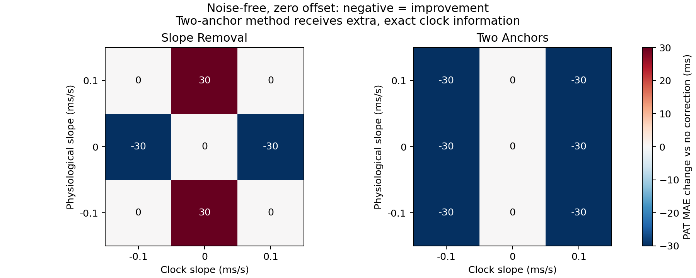

# Assignment 04: When correction helps, harms, or lacks information

Date: 2026-11-16. Contributor: Bhargav Gandhi, with Codex-assisted research,
implementation, and validation. These are synthetic model results.

## Research advance

Assignment 03 demonstrated two indistinguishable observations. This assignment
independently varies physiological slope, clock slope, constant clock offset,
observation noise, and uncertainty in two independent clock measurements.
It asks whether extra timing information resolves the ambiguity and at what cost.

## Analytical prediction (our derivation)

Let true PAT be 200 + p*t and clock error be b + c*t, with t in seconds and
delays in milliseconds. In the noise-free case, observed delay is 200+b+(p+c)*t.
Subtracting the observed slope produces 200+b: the PAT error is b-p*t.
Without correction the error is b+c*t.

For b=0 and the uniform time grid 0..600 seconds, the two MAEs are therefore
300*abs(p) and 300*abs(c). Slope removal helps only when abs(p)<abs(c), hurts
when abs(p)>abs(c), and ties otherwise. This is a conditional mathematical
result, not a population estimate. Unknown p and c cannot be separated from
their sum using this observation model alone.

Two independent, exact clock measurements at the endpoints identify b and c
when the clock error is affine. They do not identify arbitrary nonlinear clock
error. An explicit test uses clock errors [0,20,0] ms: exact zero-error endpoints
leave the 20 ms interior error undetected.

## Design and information available to each method

All ranges below are synthetic stress settings, not literature-derived normal
physiology or measured device specifications.

| Variable | Values |
| --- | --- |
| Physiological slope p (ms/s) | -0.1, 0, 0.1 |
| Clock slope c (ms/s) | -0.1, 0, 0.1 |
| Clock offset b (ms) | 0, 20 |
| Observation noise SD (ms) | 0, 5 |
| Clock-anchor measurement noise SD (ms) | 0, 5 |
| Seeds per condition | 0 through 19 |

There are 72 conditions, 1,440 simulated runs, and 5,760 method evaluations.
Each contains 601 known event pairs over 600 seconds. Initial true PAT is 200 ms.
Noise is independent zero-mean Gaussian at each event; the two anchor errors
are independent Gaussian draws from a separate random stream. The same seed
reuses underlying noise across conditions for paired comparisons. Zero-noise
repeats are identical; they do not create extra evidence.

| Method | Inputs |
| --- | --- |
| No correction | Observed delay |
| Slope removal | Reference time and observed delay |
| Two-anchor correction | Observations plus two independently simulated clock-error measurements |
| Oracle | Observations plus exact simulated clock error at every event |

The anchor estimator receives measured anchor values, not true PAT or hidden
clock arrays. Its advantage is additional information, not evidence of a superior
algorithm under equal inputs. No hardware is needed for this simulation.

## Results

The full [aggregate table](assignment-04/aggregate.csv) reports mean and sample SD
across seeds for PAT MAE, endpoint error, and change distortion. It also reports
paired MAE differences versus no correction. Negative differences mean improvement.
These SDs are simulation variability, not clinical confidence intervals.



The zero-offset, zero-noise cells agree with the analytical boundary above.
Exact anchors recover the affine clock contribution and preserve the physiological
trend; observation noise remains. Slope removal alone does not remove constant
clock offset: with p=0, c=0.1 and b=20 ms its MAE remains 20 ms.

An illustrative adverse case is p=0.1, c=0, b=0, with 5 ms observation-noise SD
and 5 ms anchor-noise SD. We deliberately report this no-drift case because a
method should be evaluated when correction is unnecessary as well as useful:

| Method | PAT MAE mean (ms) | Across-seed SD (ms) |
| --- | ---: | ---: |
| No correction | 4.009 | 0.081 |
| Slope removal | 30.052 | 0.468 |
| Two noisy anchors | 5.403 | 1.571 |
| Oracle | 4.009 | 0.081 |

Noisy anchors reduce distortion relative to slope removal here, but still worsen
MAE relative to doing nothing. The full table is provided to avoid treating this
selected condition as overall performance. Anchor uncertainty must be evaluated;
the presence of anchors is not a guarantee that correction is beneficial.

## Updated literature position

1. **Ruffolo et al., 2025, published research.** The author lab's abstract confirms
   beat matching based on variability, experimental timing-system profiling,
   and modeling of finite-resolution uncertainty. Our generic anchor simulation
   is not a reproduction of that method. Full published-method review remains
   outstanding; the medRxiv full-text endpoint again returned an access error.
   [Author-lab abstract](https://chai.cs.toronto.edu/publications/),
   [published DOI](https://doi.org/10.1088/1361-6579/ae1b70).
2. **VitalDB metrology atlas, 2026, project documentation.** Its sawtooth study
   describes injection-based validation and confidence-tiered correction. It
   explicitly notes that shifting each recording to an adopted median PAT can
   remove real differences between patients. This is closely related work and
   narrows any claim of novelty. We read the methods/discussion page, not the
   underlying implementation or data. Treat its numbers as project-reported,
   not independently reproduced or established peer-reviewed evidence; the
   site is not assumed to be an official VitalDB publication.
   [Study and implementation links](https://vitaldb.metrology-atlas.org/studies/ppg-sawtooth.html).

The earlier [seven-source review](assignment-02-literature-and-hypothesis.md)
remains relevant. Our potential contribution needs to be more specific than
"benchmark timing correction": a benchmark that varies physiological change
independently, labels each method's information requirements, and measures the
cost of correcting when evidence is inadequate. Novelty is still unverified.

## Validation and reproduction

From the activated environment at the repository root:

```bash
python -m unittest discover -s tests -v
python -m experiments.timing_sweep
```

All 16 tests pass locally, including the original seven. New checks cover the
analytical boundary, clock offset, noise seed behavior, exact-anchor/oracle
agreement, anchor bias, nonlinear-clock counterexample, invalid inputs, and
sweep cardinality/reproducibility. CI now runs both experiments; hosted execution
has not been confirmed for this commit.

Generated outputs are in `results/assignment-04/`. Curated evidence includes
[aggregate metrics](assignment-04/aggregate.csv), [per-run metrics](assignment-04/trials.csv),
and [settings and source hashes](assignment-04/metadata.json). Dependencies remain
those pinned for Assignment 03. Image generation uses the existing Matplotlib setup.

## Limits and next decision

The sweep uses affine changes, known beat pairing, independent Gaussian noise,
and exactly two endpoint anchors. It omits missing beats, quantization,
correlated noise, waveform morphology, real devices, and clinical data. The
nonlinear example is a counterexample test, not a nonlinear-clock benchmark.

Next test nonlinear drift and uncertain anchor spacing, then design a decision
rule that can decline correction when the evidence is weak. Use separate seeds
for developing and evaluating that rule. Before claiming novelty, audit the
related public implementation and obtain the detailed published methodology.
