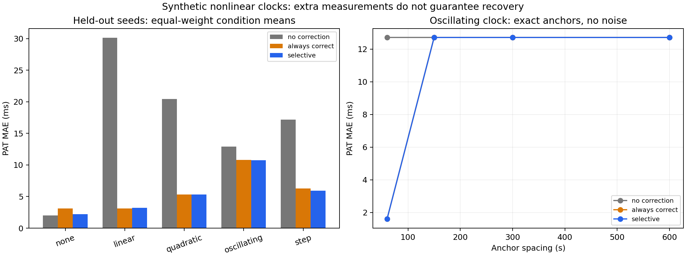

# Assignment 05: Nonlinear drift and selective correction

Date: 2026-11-23. Contributor: Bhargav Gandhi, with Codex-assisted implementation
and analysis. This extends [Assignment 04](assignment-04-sensitivity.md).

## Question

Can a correction rule reduce harm from noisy clock measurements while preserving
useful correction when clocks change nonlinearly? Which changes remain invisible
between measurement times?

## Protocol and information assumptions

This is our synthetic experimental design, not a reproduction of a published
method. All amplitudes, noise levels, and thresholds are experimental choices.
The prior-work citations and novelty limitations remain in the
[Assignment 02](assignment-02-literature-and-hypothesis.md) and
[Assignment 04](assignment-04-sensitivity.md) reports. No external recordings or
new internet-derived physiological claims are introduced in this assignment.

Each run has 601 known event pairs over 600 seconds, initial PAT 200 ms, and
physiological slope 0 or 0.1 ms/s. Observation-noise and independent anchor-noise
standard deviations are each 0 or 5 ms. Anchor spacing is 60, 150, 300, or 600 s;
all conditions include endpoints. The anchor-noise SD is assumed known to the
algorithm. That is additional information a real system would need to estimate.

| Clock profile | Clock error in ms, with t in seconds |
| --- | --- |
| None | 0 |
| Linear | 0.1*t |
| Quadratic | 60*(t/600)^2 |
| Oscillating | 20*sin(2*pi*t/300) |
| Step | 0 before 275 s; 30 thereafter |

The grid has 160 conditions. Development uses seeds 0–9; evaluation uses seeds
100–119. These splits separate noise realizations, not condition types or
populations. Signal noise is reused across conditions for paired comparisons.
Anchor noise uses a separate stream keyed by seed and anchor time, so shared
measurement times have the same error across spacing conditions.

## Correction rule and baselines

Between adjacent clock measurements, linearly interpolate the measured clock
error. With interpolation weight w and independent endpoint measurement errors
of standard deviation sigma, our propagated variance is
sigma^2*((1-w)^2+w^2). This follows by adding the variances of the weighted,
independent errors. It does not include clock curvature or unobserved jumps.

The selective rule subtracts the estimated clock error at an event only when
its absolute value exceeds k times the propagated standard deviation. A 1e-12 ms
numerical floor suppresses floating-point near-zero corrections. Otherwise it
leaves that event unchanged. This is an event-level heuristic, not a calibrated
confidence guarantee or a whole-recording safety decision.

Choose k from {0,1,2,3} by minimizing mean development PAT MAE with equal weight
per specified condition and seed. Break ties toward the smaller k. Freeze it
before evaluating the held-out seeds. Ground truth is used for development
scoring and evaluation, but never supplied to the selective estimator.

Compare no correction, always applying the interpolated estimate, the selective
rule, and an oracle that knows true clock error at every event. The first three
methods do not receive true PAT; the oracle is a privileged-information control.
The comparison does not imply equal information across all methods.

## Measurements

Report PAT MAE, endpoint error, change distortion, and their across-seed SDs for
every condition. Also record corrected-event fraction, paired MAE difference
versus no correction, and the fraction of trials where MAE worsens by more than
1 ms. This 1 ms margin is an arbitrary reporting criterion, not clinical harm.

The all-condition averages depend on the grid weighting; they are not expected
performance in a real population. Seed variability is not clinical uncertainty.
Exact/no-noise repeats do not create independent evidence.

## Evidence and reproduction

### Measured outcomes

Development MAE for k=0,1,2,3 was 5.618, 5.507, 5.430, and 5.468 ms,
respectively, selecting **k=2**. Evaluation comprised 160 conditions times 20
held-out seeds: 3,200 runs and 12,800 method evaluations. There were a further
1,600 development runs. Counts describe a factorial simulation, not participants
or independent clinical samples.

| Method | Evaluation mean PAT MAE (ms) | Trials with >1 ms MAE worsening vs no correction |
| --- | ---: | ---: |
| No correction | 16.525 | 0 / 3200 (reference) |
| Always correct | 5.734 | 296 / 3200 (9.25%) |
| Selective, k=2 | 5.486 | 58 / 3200 (1.81%) |
| Oracle | 2.005 | 0 / 3200 |

These are equal-weight averages over the defined grid. The comparison supports
reduced unnecessary correction in this experiment, not a general safety claim.
Selective correction still worsens some trials and is slightly worse than always
correcting in the linear profile (3.203 versus 3.135 ms profile-average MAE).
When the clock is accurate, no correction is still best: 2.005 ms MAE, versus
2.196 ms for selective and 3.135 ms for always correcting.



In the exact-anchor, zero-observation-noise oscillating case, the selective MAE
is 1.594 ms at 60 s spacing, but 12.711 ms at 150, 300, and 600 s spacing. Those
coarser sample times coincide with zeros of the chosen oscillation; apparently
perfect anchors miss the intervening changes. This is a deliberately exposed
sampling failure, not evidence that every signal needs a fixed sampling interval.
Always-correct and selective curves coincide in this panel; both equal no
correction at the coarser spacings.

The gate models measurement noise only. It cannot certify that no clock error
exists between anchors, and declining correction does not mean the data are
accurate. That is the central unresolved issue carried into the next assignment.

Full evidence: [per-condition metrics](assignment-05/aggregate.csv),
[per-run metrics](assignment-05/trials.csv), and
[settings, seed split, threshold selection and source hashes](assignment-05/metadata.json).

```bash
python -m unittest discover -s tests -v
python -m experiments.selective_correction
```

The runner exports full per-run and per-condition metrics, settings, selected
threshold, source hashes, and a figure to `results/assignment-05/`. Curated
snapshots are linked below. Previously completed experiments remain unchanged.

Twenty-five local tests pass. The nine new tests cover affine interpolation,
irregular anchors, propagated variance, threshold behavior, hidden oscillation,
unchanged accurate-clock data, input validation, reproducibility, profile
definitions, seed separation, and deterministic threshold selection. Hosted CI
must still be checked after submission.

## Limitations and next step

The variance calculation assumes independent Gaussian errors with known SD;
correlated noise, uncertain SD, missing beats, device filtering, waveform
features, and real data are absent. The gate may introduce discontinuities as
it switches correction on and off. Sparse measurements can miss clock changes
even with zero measurement noise. The study does not establish novelty or
clinical effectiveness.

The next research increment should address interpolation/model error explicitly:
compare scheduled versus independently jittered measurement times, challenge
the method on previously unseen clock shapes, and assess calibration of any
proposed uncertainty bound. Preserve the hidden-oscillation case as a regression
test. Do not tune the current threshold on its held-out results and describe
that same set as an untouched evaluation.
