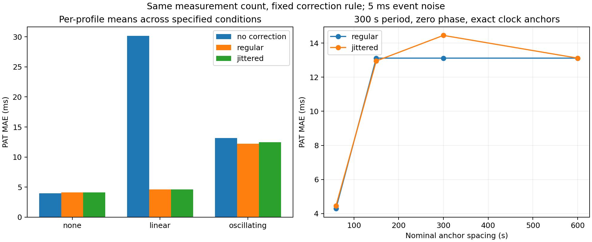

# Assignment 06: Does changing measurement times improve correction?

Date: 2026-11-23. Contributor: Bhargav Gandhi, with Codex-assisted implementation
and analysis. This extends [Assignment 05](assignment-05-selective-correction.md).

## Question and protocol

Regular clock measurements can coincide with zero crossings of an oscillating
clock error. Does changing their times recover timing more accurately with the
same measurement budget? Detecting a nonzero error and reconstructing the full
clock trajectory are different objectives.

The correction method is unchanged: linear interpolation of clock measurements
and the Assignment 05 gate with k=2. There is no threshold tuning in this study.
Regular schedules are compared with jittered schedules whose interior times
move independently by up to 30% of the nominal interval. Endpoints remain fixed,
measurement count is identical, and time order is preserved. Jitter amplitude
was fixed before this run; this is an exploratory protocol, not a preregistration.

| Variable | Values |
| --- | --- |
| Clock profiles | Accurate clock, linear drift, sinusoidal drift |
| Oscillation periods | 120, 200, 300, 450 s |
| Oscillation phases | 0, pi/4, pi/2 radians |
| Oscillation amplitude | 20 ms |
| Linear clock slope | 0.1 ms/s |
| Nominal measurement spacing | 60, 150, 300, 600 s |
| Clock-measurement noise SD | 0, 5 ms |
| Event timing noise SD | 5 ms |
| True PAT | 200 + 0.1*t ms |
| Duration and event count | 600 s, 601 events |
| Evaluation seeds | 200–219, unused in Assignment 05 |

All settings are synthetic experimental choices, not physiological reference
ranges. The 12 oscillation shapes plus two control profiles give 112 conditions
and 2,240 paired runs. Four outputs per run yield 8,960 method evaluations:
no correction, regular-schedule correction, jittered-schedule correction, oracle.
The oracle has exact clock error and is only a privileged-information control.

Signal noise is shared across methods and conditions for a given seed. Clock
measurement noise is paired by measurement index across schedules; the jitter
stream is separate. Schedules are saved for inspection. Newly introduced periods
and phases broaden the earlier test, but the model family is still synthetic.

At 600 s spacing there are only two fixed endpoints, so jitter changes nothing.
This is a deliberate negative control, not an extra independent treatment.

## Results

| Clock profile | No-correction MAE | Regular-schedule MAE | Jittered-schedule MAE |
| --- | ---: | ---: | ---: |
| Accurate clock | 3.977 | 4.122 | 4.122 |
| Linear drift | 30.159 | 4.637 | 4.628 |
| Oscillating drift | 13.184 | 12.240 | 12.492 |
| All specified conditions | 13.739 | 11.117 | 11.333 |

Values are mean PAT absolute error in ms, averaged equally over conditions and
seeds in each row. The all-condition row weights oscillations more heavily because
96 of 112 conditions are oscillating. It is not an estimate of real-world prevalence.

Across the full grid, jitter reduced MAE by more than 1 ms in 7.10% of paired runs
and increased it by more than 1 ms in 15.09%. Its mean paired change was +0.215 ms.
The 1 ms margin is a reporting choice, not a clinical limit. These percentages
describe the specified simulations; no population significance claim is made.

For the original 300 s, zero-phase oscillation with exact clock measurements:

| Nominal spacing | Regular MAE (ms) | Jittered MAE (ms) |
| --- | ---: | ---: |
| 60 s | 4.294 | 4.450 |
| 150 s | 13.116 | 12.951 |
| 300 s | 13.116 | 14.450 |
| 600 s | 13.116 | 13.116 |



The targeted test confirms that jitter can expose a nonzero clock error missed
by the regular 150 s schedule. Nevertheless, sparse interpolation can remain
inaccurate, and the 300 s result worsens. Exposing an error does not establish
that the resulting correction is reliable. We therefore do not promote this
jitter policy as a general improvement.

## Evidence, tests, and reproduction

```bash
python -m unittest discover -s tests -v
python -m experiments.anchor_schedule
```

The [per-run metrics](assignment-06/trials.csv),
[per-condition aggregates](assignment-06/aggregate.csv),
[actual schedules](assignment-06/schedules.csv), and
[settings and source hashes](assignment-06/metadata.json) record the experiment.
Across-seed SDs and paired differences are included. Reused noise and repeated
control settings must not be treated as independent clinical evidence.

All 32 tests pass locally. Seven new tests cover equal budgets, endpoint/order constraints, jitter bounds,
seed behavior, the two-endpoint negative control, hidden-error exposure, exact
affine reconstruction, accurate-clock preservation, invalid settings, frozen
threshold, and repeatable exports. Earlier regression tests are retained.
Hosted CI is configured but has not been verified for this submission.

## Limits and next decision

This study assumes known beat pairing, known independent Gaussian measurement
noise, exact measurement timestamps, and a fixed physiological trend. The gate's
uncertainty still excludes interpolation error. It does not account for real
sampling/communication costs, missing data, filtering, or waveform landmarks.

Before adding more synthetic cases, audit a suitable public ECG/PPG recording's
timing documentation and acquisition assumptions. Then inject known errors into
copies to test whether the synthetic failure patterns survive real signal
processing. Original timing must remain a reference, not asserted perfect
physiological truth. Keep this negative result as a regression baseline.

All numerical findings and schedule design here are our simulation outputs.
Prior external evidence and novelty limits remain cited in the Assignment 02
and Assignment 04 research notes. No new external clinical claims are made.
