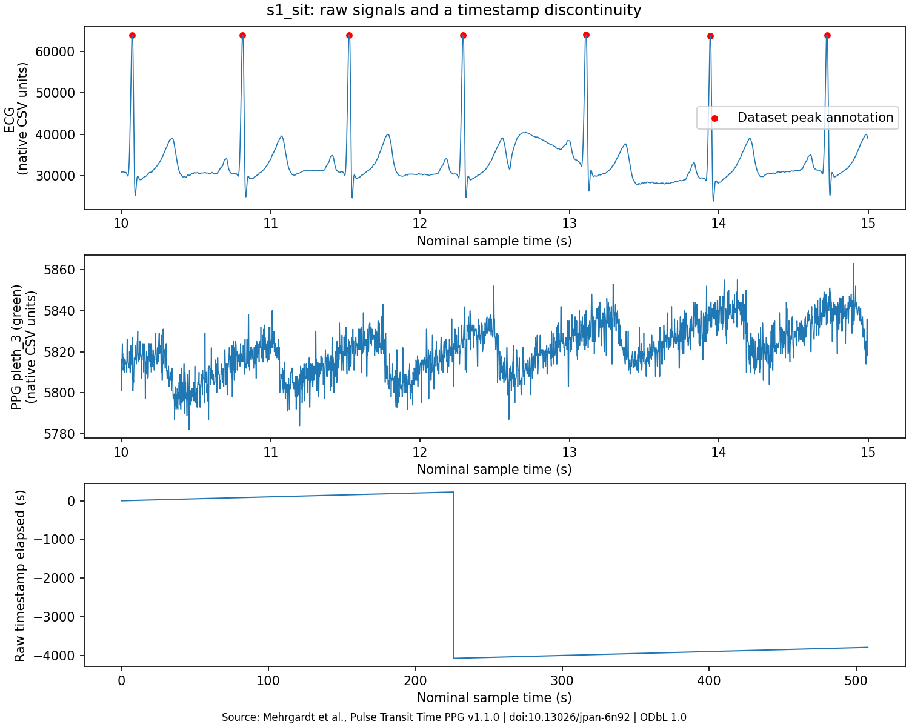

# Assignment 07 — Audit a public ECG/PPG recording

## Research question and decision

Can a public recording support the next controlled timing-error experiment,
and which timing assumptions must be made explicit first?

**Decision: reject the raw CSV timestamp column as a continuous timeline.**
The sample sequence is a candidate for a subsequent experiment using nominal
sample time, but this is conditional on that assumption and signal-quality checks.
No clock correction, pulse-arrival detection, or real-data efficacy evaluation
is performed in this assignment.

## Source and selection

Use Mehrgardt, Khushi, Poon and Withana (2022), *Pulse Transit Time PPG Dataset*,
version 1.1.0, [DOI:10.13026/jpan-6n92](https://doi.org/10.13026/jpan-6n92).
The source describes synchronized ECG and PPG, ECG peak annotations, CSV timestamps,
and acquisition within a 2 ms microcontroller window. These statements describe
acquisition; they do not establish error-free exported timestamps. [Dataset documentation](https://physionet.org/content/pulse-transit-time-ppg/1.1.0/).

Select `s1_sit` deterministically: first subject, sitting recording. This is a
pipeline qualification case, not a representative cohort or a record selected
for favorable correction results. Select `ecg`, `peaks` and `pleth_3`. Green PPG
is consistently identified as `pleth_3`; the documentation's red/infrared channel
mapping differs between Methods and Data Description. It also distinguishes
1000 Hz PPG device configuration from 500 Hz distributed channels. Use the
record header's 500 Hz nominal rate, not the device configuration rate. [Source](https://physionet.org/content/pulse-transit-time-ppg/1.1.0/).

## Reproduction and provenance

From the repository root in the existing Python environment:

```bash
python -m experiments.dataset_audit --download
python -m unittest discover -s tests -v
```

Subsequent runs can omit `--download`. The downloader only retrieves absent files;
it verifies existing files and preserves them if their checksums disagree. Failed
downloads leave no accepted partial file. Downloaded inputs are CSV, header,
publisher checksum manifest and license, from the fixed versioned URL.

The CSV SHA-256 is checked against both the pinned digest and publisher manifest.
All four input hashes and the audit source hash appear in
[the numerical artifact](assignment-07/audit.json). Raw inputs remain under
`data/raw/`, ignored by Git. No new Python dependency was introduced.

The audited CSV has 254,026 rows; its header agrees. There are 18 signal channels
in the header and 20 CSV columns: those channels plus time and peak annotation.
Every numeric CSV column is checked for finite values; peak annotations must be
binary. This structural check does not establish signal quality or annotation
accuracy. Amplitudes are displayed in native CSV units without calibration.

## Measured results

These are measurements of the pinned files, not claims taken from a paper.

| Check | Result |
| --- | --- |
| Sample count | 254,026 |
| Nominal header sampling rate | 500 Hz |
| Last sample time, `(N-1)/fs` | 508.050 s |
| Annotated ECG peaks | 613 |
| Nonfinite values across numeric columns | 0 |
| Timestamp intervals of 2,000 microseconds | 254,023 |
| Timestamp intervals of 2,001 microseconds | 1 |
| Backward intervals | 1 |
| Backward interval location | Zero-based row 113,094, nominal time 226.188 s |
| Backward interval size | -4,294,965,296 microseconds |
| Raw last timestamp minus first timestamp | -3,786.917295 s |

The backward interval equals `2000 - 2**32` microseconds. This is **consistent
with a 32-bit microsecond counter rollover**, but its cause is unconfirmed.
Adding `2**32` microseconds to times after the discontinuity would produce a
508.050001 s span. That arithmetic is a diagnostic observation, not an applied
repair or evidence that the acquisition clock was accurate. Original timestamps
and raw files remain unchanged.



The signal panels show a fixed 10–15 s nominal-time window. ECG markers come from
the supplied annotations. No PPG landmarks have been detected. The third panel
plots all raw elapsed timestamps against sample index divided by 500.

## Acceptance rules and limitations

The audit flags nonpositive timestamp increments and increments differing from
the nominal period by more than 1 microsecond. The tolerance permits the observed
1 microsecond variation; it is an explicit audit setting, not an accuracy claim.
This recording fails that timeline check. Successful CLI exit means the audit
completed, **not** that the recording passed; consult
`raw_timestamp_timeline_accepted` in the JSON.

Sample index divided by 500 assumes uniform acquisition and no missing samples.
Matching header counts and mostly regular timestamps do not prove that assumption.
A shared timestamp discontinuity does not demonstrate relative ECG–PPG clock
drift, physiological change, or failure of a particular synchronization algorithm.
We have not identified independent clock-reference observations in this audit.
The file cannot supply ground truth for separating unknown physiological change
from unknown real clock error merely because its signals were recorded together.

All 43 local tests passed, including 11 new audit tests covering checksum failures,
offline behavior, partial download cleanup, backward jumps, gaps, duplicates,
rounding tolerance, malformed values, sample counts and deterministic results.
Existing CI discovers these tests automatically using small synthetic fixtures;
it does not download the public recording. Hosted CI status remains to be checked
on the PR. Numerical outputs were reproduced locally from the same input hashes.

## Next experiment

1. Define and document the nominal timeline explicitly; retain the timestamp
   failure as provenance rather than silently unwrapping it.
2. Implement a PPG landmark detector with predeclared windows and quality rules.
   Visually inspect accepted and rejected beats; compare landmark choices.
3. Establish a baseline delay series and inject known timing perturbations into
   copies. Score recovery of the injected perturbation separately from changes
   introduced by filtering or landmark detection.
4. Call this a controlled, semi-synthetic evaluation. Do not treat baseline delays
   as ground-truth physiology or claim recovery of unknown real-device drift.
5. Expand to additional records only after this pipeline and its exclusions are
   reproducible; report failed records and retained fractions.

## Attribution and license

This report and figure use information from *Pulse Transit Time PPG Dataset*
(version 1.1.0), Mehrgardt et al. (2022), made available under the
[Open Data Commons Open Database License v1.0](https://physionet.org/content/pulse-transit-time-ppg/view-license/1.1.0/).
The [source database](https://physionet.org/content/pulse-transit-time-ppg/1.1.0/)
and versioned license are linked here; the original license is retained with the
local downloaded inputs. Dataset licensing is distinct from project code licensing.

PhysioNet platform citation requested by the source: Pollard et al. (2026),
*PhysioNet as a global platform for biomedical research*, Nature Health,
[doi:10.1038/s44360-026-00096-z](https://doi.org/10.1038/s44360-026-00096-z).
